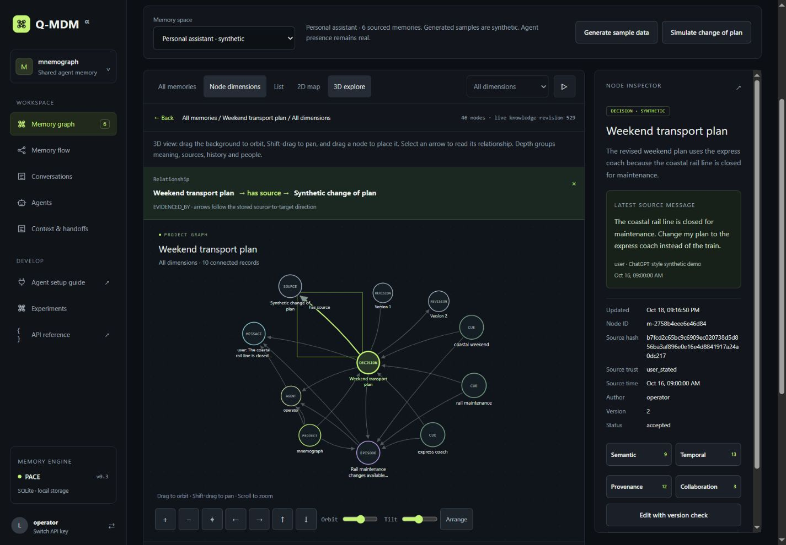

# Q-MDM

Shared, persistent memory for independent agents. The backend owns the memory;
Codex, Claude Code, custom programs, and local LLM agents access it through MCP
or REST. A localhost dashboard explores the same records and recall traces.

Q-MDM uses the `mnemograph` Python package for compatibility with existing clients.
This is a working foundation described in the [v2 specification](docs/v2/system-spec.md).
The supplied research contains future ideas, not implementation claims. The
[source review](docs/research-v2-source-review.md) records what informed the build.
The current product is independent of the original hackathon. See the
[product update](docs/product-update-2026-10-20.md) and
[database decision](docs/storage-decision-2026-10-20.md).



## Run locally on Windows

```powershell
# Run from the cloned repository folder
.\start.ps1
```

Open **http://127.0.0.1:8000**. Paste the `operator` key from `.local/keys.json`.
Python 3.11 or newer is required.
The launcher creates a virtual environment and installs dependencies if needed.
It selects SQLite as the supported local database. The API retains the legacy
`sqlite-development` identifier for existing clients. No cloud or LLM key is needed.
Stop the service with Ctrl+C in its terminal.

Manual setup, also usable on Linux/macOS with `.venv/bin/python`:

```powershell
python -m venv .venv
.\.venv\Scripts\python.exe -m pip install -e '.[dev]'
.\.venv\Scripts\python.exe -m mnemograph init
.\.venv\Scripts\python.exe -m mnemograph serve --backend sqlite
```

The dashboard starts empty. Choose **Personal assistant**, **Camera lab** or
**Team planning**, then **Generate sample data**. Each has labeled synthetic
messages and memories. **Simulate change of plan** creates a real revision and
replaces its active evidence links. **Conversations** shows the messages outside
the graph. Every node exposes four logical dimensions. An agent appears active
only after an authenticated heartbeat and goes
idle after 90 seconds. Browser/operator activity is labeled `dashboard`.

## Use FalkorDB

FalkorDB is an optional adapter. SQLite is the supported default; no database
vendor is mandatory. Data does not move between backends. The launcher installs
the optional `falkordb` extra when selected.

With Docker installed:

```powershell
docker compose up -d
$env:MNEMO_FALKOR_URL = 'redis://127.0.0.1:6379'
.\start.ps1 -Backend falkordb
```

The Compose file pins FalkorDB v6.0.2, binds Redis to loopback, and enables AOF
persistence in a named volume. `everysec` can lose the last second during an
abrupt machine failure. Do not remove the volume to restart the service.

The FalkorDB adapter uses native graph nodes and typed relationships, native
cue/relationship traversal, and a guarded graph write for revisions and receipts.
**Its contract tests were not run on this machine because Docker/WSL are absent.**
Run them against the exact server version before relying on this deployment:

```powershell
$env:MNEMO_TEST_FALKOR_URL = 'redis://127.0.0.1:6379'
.\.venv\Scripts\python.exe -m pytest -q
```

Tests create graphs under randomized project names. They intentionally retain
these small test graphs for inspection; use a dedicated test server.

## Connect an agent

See [integration instructions](docs/integrations.md) and the dashboard's
**Agent setup guide** view for Codex TOML, Claude Code JSON, Python, and REST.
The guide generates commands for the running server and selected agent identity.
It distinguishes an API connection check from a matching agent heartbeat. It
does not modify existing host settings or claim that an LLM session ran.

Test an agent identity in its launching terminal after setting `MNEMO_TOKEN`:

```powershell
.\.venv\Scripts\python.exe -m mnemograph check
```

```python
from mnemograph.client import MemoryClient

# Set MNEMO_TOKEN to the agent's own key before launching it.
with MemoryClient() as memory:
    memory.connect("custom-python", "Continue the camera pipeline")
    startup = memory.context()
    packet = memory.recall("camera mounting", budget_chars=2400)
    for handle in packet["handles"]:
        evidence = memory.expand(handle["id"], handle["version"])
        # Pass only needed evidence to your model as untrusted data.
```

Provision another identity without editing source code:

```powershell
.\.venv\Scripts\python.exe -m mnemograph issue --agent local-coder
# Another project with read-only access:
.\.venv\Scripts\python.exe -m mnemograph issue --agent auditor --project atlas --actions read
```

New keys go into `.local/keys.json` under `tenant/project/agent`; restart the service
to load updated grants. Keep this ignored directory private. The service stores
token hashes in `credentials.json`; the local keys file contains raw credentials
for setup. Removing a grant and restarting revokes its key. There is no hosted
identity provider or encrypted secret vault in this foundation.

## What works

- Exact source messages, candidate staging, core, episodic, fact, decision,
  procedural, resource, hypothesis and insight records.
- BM25, lexical TF-IDF cosine, bounded graph traversal, PPR and PACE evidence
  bundles, plus an experimental classical quantum-walk simulation. Up to eight
  seeds, two hops and forty visited candidates per graph recall.
- Compact handles under a strict character budget, followed by explicit evidence
  expansion. Token use and model latency are not estimated or benchmarked.
- Expected-version updates, immutable history, and payload-bound retry receipts.
- Server-derived tenant/project/agent scope, including links, traces, and tasks.
- Private records, selected project readers and owner-controlled sharing,
  covering historical reads and linked derivatives too.
- Typed lifecycle links, explicit supersession, structured claim conflict checks,
  archival and a separate live-store forgetting operation.
- Versioned handoffs to a provisioned agent, with owner/author update checks.
- Explicit checkpoints, bounded task leases, fencing tokens and action receipts.
- Heartbeats, recorded recall context, changes, and graph dimensions in the UI.
- Interactive graph with draggable nodes, session-persisted placements, directed
  arrows and plain-language relationship explanations.
- 2D and perspective 3D views of the same records, with orbit, tilt, pan, zoom,
  keyboard inspection, dimensions, a list, source timestamps and history.
- Reproducible retrieval experiments with raw trials, seven comparison metrics,
  PNG/SVG figures and a dashboard view of the saved run.

The client does not read private host conversations, rewrite model weights, or
automatically capture agent activity. Your agent must invoke the tools. Graph
motion is decorative; highlighted paths and context records come from real
retrieval calls. “Accepted” is an agent-assigned status, not verified truth.

## Verify

Start the service before running the two integration checks:

```powershell
.\.venv\Scripts\python.exe -m pytest -q
.\.venv\Scripts\python.exe examples/cross_agent.py
.\.venv\Scripts\python.exe examples/check_mcp.py
node --check mnemograph/web/app.js
node tests/graph-engine.test.cjs
```

The process demo uses distinct researcher/developer credentials and creates
synthetic memory and a task. The MCP check launches a real stdio subprocess,
discovers tools, and exercises connect, recall, and expansion. Neither script
calls an LLM. See [verification results](docs/verification.md).

The stdio check discovers 14 tools and also records an exact message, stages a
candidate, and saves a checkpoint. For a provider-neutral agent loop, see
[the adapter example](examples/agent_tool_loop.py). Supply the model SDK callback;
the included test uses scripted turns and does not call a real provider.

## Research and experiments

Start with [the complete v2 specification](docs/v2/system-spec.md). It maps the
requested criteria to working code and names the remaining work. The
[source review](docs/research-v2-source-review.md) covers the supplied paper list
and selected engineering sources; [scan adoption](docs/research-scan-adoption.md)
maps the additional design scan to the actual implementation.

```powershell
.\.venv\Scripts\python.exe -m benchmarks.run
```

The saved run contains 2,592 synthetic retrieval trials across six local methods.
Graph methods tie on these correctly linked fixtures. Every method has a 50%
zero-result rate on missing-fact queries. There is no demonstrated PACE/QWAM
advantage over the simpler graph baseline. These are retrieval measurements,
not answer accuracy or vendor comparisons. See [results and charts](artifacts/benchmarks/README.md).

The [Medium draft](docs/blog-medium.md) includes comparison graphs and measured
limits. The [demo script](docs/demo-script.md), original submission checklist and
[78-second silent walkthrough](artifacts/mnemograph-v2-walkthrough.mp4) remain
historical materials from the v2 build. The video predates the current graph
controls. No Medium publication or model-provider deployment is claimed.

## Explore the memory

1. Generate a labeled sample or add a sourced memory.
2. Select a node to inspect the latest source message and time. Use its dimension
   buttons for semantic, temporal, provenance and collaboration neighborhoods.
3. Hover or keyboard-focus an arrow to read its verb. Select it for the full
   source-to-target explanation, including the stored relation type.
4. Drag nodes to arrange them. Placements persist across page reloads in the
   current browser session. **Arrange** restores the automatic layout.
5. Select **3D explore** and use Orbit/Tilt or drag the background. Shift-drag pans.
   Return to **2D map** to keep the same selected memory. Depth groups record
   categories; it is not a learned embedding or quantum coordinate.
6. Use **Conversations** and **Memory flow** to follow messages and changes without
   navigating a graph. **Agent setup guide** keeps host configuration and
   connection feedback together.

## Database choice

The probable Tencent project is [TencentDB Agent Memory](https://github.com/TencentCloud/TencentDB-Agent-Memory),
a memory framework whose documented default is SQLite. Replacing our store with
that framework would be a broader application change. Keep one transactional
source of truth for current claims, revisions, evidence, permissions and tasks.
The [storage review](docs/storage-decision-2026-10-20.md) compares Tencent projects,
PostgreSQL/pgvector, LadybugDB, Neo4j, FalkorDB and Infinity. PostgreSQL is the
proposed service-scale target when a measured workload warrants migration.
No alternative engine was installed or benchmarked. Quantum-inspired ranking
runs in application code and does not require a special database.

## Extend the foundation

Read [architecture](docs/architecture.md) before adding a new retrieval algorithm,
provider, schema, or integration. `RetrievalStrategy` and `Store` are the two
deliberate replacement boundaries. REST, MCP, and UI share the service's rules.
API documentation is at `/api/docs`; the schema is `/api/openapi.json`.

This version loads small project snapshots. It needs indexed candidate search,
paged history, operational limits, migrations, backup/restore, stronger identity
management, and load testing before large or hosted workloads. Neural embeddings,
automatic extraction/consolidation, semantic contradiction resolution, answer
verification and distributed-runtime lease validation remain future work.
Streamable HTTP MCP and OAuth for native remote ChatGPT access are not installed.
