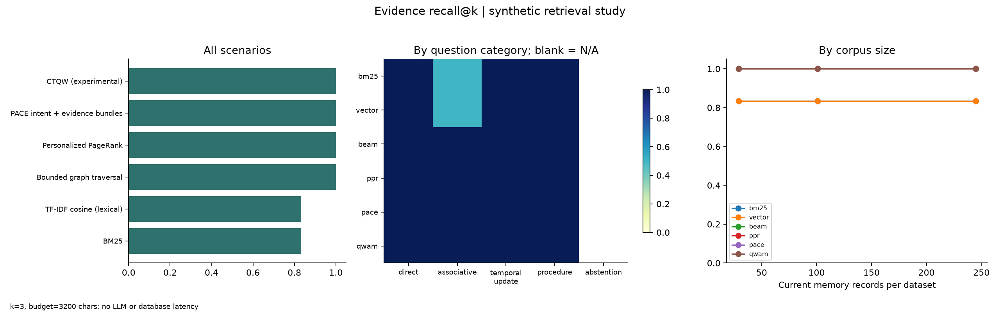
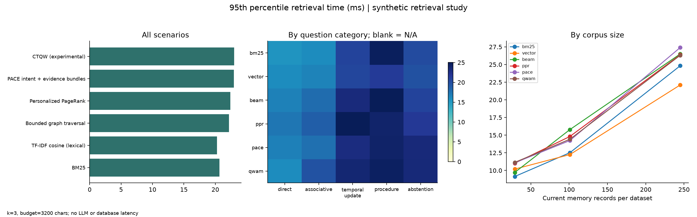
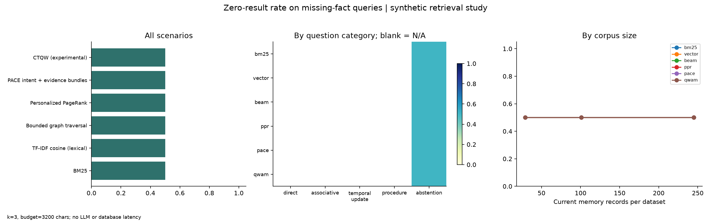

# A memory layer that can explain a changed decision

An agent remembers that a trip should use the Saturday train. A later message says the rail line is closed and asks for a coach instead. Saving both messages is easy. The harder job is giving the next agent the current plan, preserving the old one, and showing which message caused the change. Q-MDM, built on the MnemoGraph service, is a working foundation for that job. Its main integration point is the agent's tool loop: retrieve a few memory handles, open the relevant evidence, and save a sourced outcome with a version check.

## Start with the message

The local demo uses Maya, a synthetic assistant user with dinner preferences, a Spanish study routine and a coastal weekend plan. The conversation view displays exact sample messages and their timestamps. Selecting the transport decision opens its source message. Applying the change of plan creates another version and replaces its active evidence link: the train plan gives way to the coach plan, supported by the maintenance message. The graph displays that recorded change. Each node can also be explored through semantic, temporal, provenance and collaboration views of the same records.

The dashboard's Memory flow page replays that path end to end: the exact message, the retention cues that kept or dropped it, the stored memory with its typed links, the recalled paths and the delivered context packet. The retention notes are computed cues over the sample data, not a trained classifier.

This keeps the visual interface tied to backend behavior. The source is distinct from the claim extracted from it. Candidate writes remain assertions; promotion requires a coordination grant. Private and selectively shared records pass through the same policy checks as direct-ID expansion and graph traversal. Checkpoints, task leases and action receipts support continuation, although an external side effect still needs cooperation from the tool performing it. An accepted memory is an agent assertion, not independent verification that its content is true.

## Keep the integration ordinary

MnemoGraph exposes local stdio MCP, REST and a Python client. Independent processes can share the service without copying a conversation into each other. MCP makes the operations callable; the host or wrapper must decide when to call them. The connection guide distinguishes Codex and Claude Code configuration from an API or local-model wrapper. It also says plainly that the ordinary ChatGPT website has not been connected. A synthetic ChatGPT-style conversation is a demo dataset, not evidence of access to a private account. No OAuth flow or real hosted model session was exercised.

The product now uses SQLite as its supported local store, with an optional FalkorDB adapter. No event sponsor determines the database. A review of TencentDB Agent Memory found that it is a memory framework and uses SQLite by default itself. I would first remove full-project snapshot work from retrieval before adding another engine. PostgreSQL is the next candidate if concurrent service use justifies migration. [Storage decision and primary sources](storage-decision-2026-10-20.md)

The explorer now offers draggable nodes and directed relationship explanations. Its 3D mode projects the same records with orbit and tilt. Depth separates record categories for inspection. It does not represent quantum state or a learned memory embedding.

## Borrow methods, then test the smaller version

The design combines existing ideas. HippoRAG 2 integrates passages with graph retrieval and Personalized PageRank. GraphMemix selects complementary evidence through query-local forests, using generative verification and a more specific optimization procedure than this prototype implements. MnemoGraph's deterministic evidence bundles are an adaptation, not a reproduction of either paper. [HippoRAG 2](https://arxiv.org/html/2502.14802v2), [GraphMemix](https://arxiv.org/html/2608.26983v1)

There is a useful counterweight to graph enthusiasm. Arize reports that Alyx fit its scoped memory into one small, always-loaded file and explicitly treats its reported evaluation as a regression check. That supports keeping a compact current briefing alongside deeper retrieval. Google's revision model also separates current consolidated memory from immutable history. Neither idea is a novelty claim for MnemoGraph. The question is whether their combination helps an independent agent continue safely. [Arize architecture](https://arize.com/blog/alyx-agent-long-term-memory-architecture/), [Google memory revisions](https://docs.cloud.google.com/gemini-enterprise-agent-platform/scale/memory-bank/revisions)

## What the local experiment measured

The benchmark ran 2,592 retrieval trials across personal, team and technical fixtures, three deterministic seeds, three corpus sizes and two repeats. All methods used a 3,200-character packet budget and were graded on their first three handles. The labels were relevant record IDs and expected versions, not model-written answers. BM25 and TF-IDF cosine are lexical baselines. The graph methods used explicit, correct synthetic links, including a supporting record with no query-word overlap. QWAM ran a classical continuous-time quantum-walk simulation; no quantum hardware was involved.

| Method | Evidence recall@3 | Complete evidence coverage | Zero-result rate on missing facts |
| --- | --- | --- | --- |
| BM25 | 0.833 | 0.667 | 0.500 |
| TF-IDF cosine | 0.833 | 0.667 | 0.500 |
| Bounded graph traversal | 1.000 | 1.000 | 0.500 |
| Personalized PageRank | 1.000 | 1.000 | 0.500 |
| PACE | 1.000 | 1.000 | 0.500 |
| QWAM simulation | 1.000 | 1.000 | 0.500 |

The graph methods tied. This run establishes no advantage for PACE over a simple bounded traversal, and no advantage for the quantum-walk experiment. PACE's median retrieval took 9.61 ms and its p95 took 22.97 ms on this machine. Those timings include local lexical indexing, but exclude the database, network and answer model. They are measurements of this small run, not a service latency promise.

The missing-fact test is the more useful failure. Unknown vocabulary produced empty packets. A known project with an absent secret still produced unrelated handles, giving every method a 50% zero-result rate. That does not establish that an answer model would reveal or invent a secret; no answer model ran. It shows that nonempty retrieval cannot certify sufficient evidence. Source opening, explicit missing-information checks and answer-level evaluation remain necessary.

The raw trials and methodology are in [the experiment report](../artifacts/benchmarks/README.md). No public LongMemEval run, competitor comparison, foundation-model training or real provider session is claimed. The next useful test is an actual two-agent task with a real model provider and a measured concurrent storage workload, with a held-out conversation and an answer judged against its sources. Making that test pass matters more than adding another ranking formula.

*Draft disclosure: AI coding assistance contributed implementation, research synthesis, experiment tooling and this draft. The submitting author should review the code and measurements, edit the voice, and describe their own contribution before publication.*
