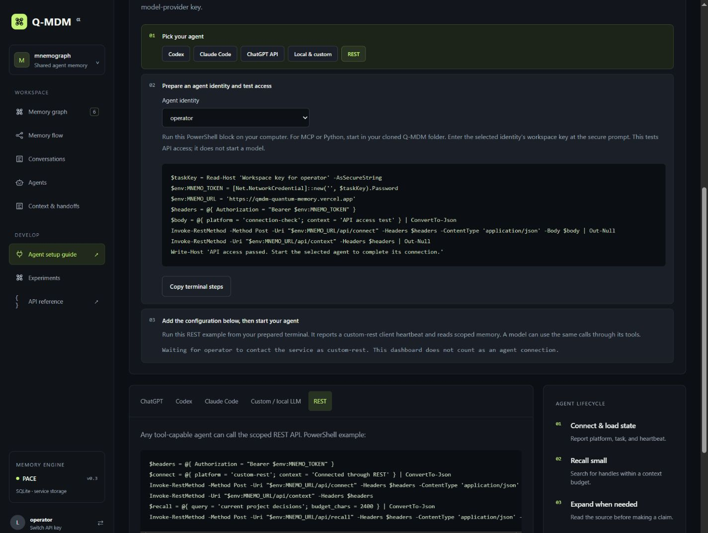

# Remote connection guide and product video

Updated on 21 October 2026, Asia/Kolkata. This follows the
[October 20 graph update](product-update-2026-10-20.md).

## What changed

The hosted guide previously copied the Vercel server's Python and file paths into
commands intended for visitors' computers. A hosted deployment now explicitly
sets `local_setup=False`. Authenticated setup metadata retains its scoped agents
and service URL but omits the server's executable, workspace and data-directory
paths. Local setup continues to return local paths.

The hosted guide prepares a local Python bridge for MCP and Python users, asks
for a workspace key at a secure prompt, and uses the dashboard's browser origin
as the target service. REST needs no Python installation. Codex and Claude Code
run the local bridge, which calls the remote REST service. This does not add an
HTTP MCP endpoint or a ChatGPT website integration.

Copying an example no longer marks the access test complete. The guide separates
an authenticated transport check from a matching host heartbeat. Hosted dashboard
activity no longer writes agent heartbeats, so it cannot overwrite a client's
platform on the public demo's shared identity. The public identity remains a demo
convenience; real agents should receive separate credentials.

Cold starts now seed the six-memory personal-assistant scenario selected by the
dashboard, including exact source messages. The previous eight generic records
were outside the selected dataset and made the first graph look empty. Repeated
initialization preserves the same seeded IDs. `MNEMO_AUTOSEED=0` still starts empty.
This remains ephemeral Vercel storage, not a durable production service.

## Product video

[One memory, every agent](../artifacts/qmdm-video/qmdm-one-memory-every-agent.mp4)
is a 20-second narrated illustration with synthetic examples. It is not a live
model session, an application recording or a performance comparison. The
[video package](../artifacts/qmdm-video/README.md) includes its storyboard, narration,
source animation, renderer, encoder and export manifest.

The renderer now accepts a normal Playwright installation or `QMDM_PLAYWRIGHT`
instead of a path tied to this computer. It rebuilds by default; explicit resume
fills missing frames and assumes unchanged sources. The encoder rejects narration
longer than the video and checks the decoded export's format before reporting success.

## Verification

- Python contracts: 43 passed, 27 optional FalkorDB cases skipped. One upstream
  Starlette deprecation warning remains. Windows sandbox ACLs blocked pytest's
  temporary folders; the suite ran outside the sandbox using isolated test data.
- Remote metadata authentication and scope, omitted paths, default local metadata,
  visible demo seeding, repeat initialization, seed opt-out and cross-origin
  rejection passed. Graph geometry and JavaScript syntax checks passed.
- In the running isolated deployment, the actual copied REST terminal steps parsed
  and reached the service. The copied Codex TOML parsed with `command="python"`
  and the correct origin; the Claude example also used client Python.
- Browser checks distinguished copy-only, API-access-passed and matching REST
  client status. Selecting Codex did not count a REST heartbeat as a Codex
  connection. The hosted guide had no document overflow at 390px. Its browser stayed open
  while the client heartbeat timestamp and platform remained unchanged for
  195 seconds; normal 90-second client expiry still applies.
- The existing MP4's SHA-256 matches the manifest. An independent FFmpeg decode
  confirmed 480 H.264 frames, 1920x1080 at 24 fps, 20 seconds and AAC audio.
  The narration WAV is 18.12 seconds. Encoded scenes were visually inspected.

A fresh video dependency installation and full frame rebuild were not repeated.
Real Codex/Claude/provider model sessions, alternative database runtimes and
production durability were not exercised. The isolated guide checks were
supplemented by the deployed checks below.

## Deployment inputs

The Vercel CLI dry run detected FastAPI and selected 24 files, totaling about
2.76 MB. `.vercelignore` allows application sources, package metadata and the two
saved benchmark JSON reports. Local databases/keys, environments, imported
conversations, scratch files and video rendering intermediates are excluded.
The selected payload was scanned against local credentials. This follows
[Vercel's documented allowlist format](https://vercel.com/docs/deployments/vercel-ignore).

## Live deployment verified

The existing [public demo](https://qmdm-quantum-memory.vercel.app) was updated from
application commit `0c6174f` on October 21. Vercel reported the existing production
alias ready. Independent requests then confirmed remote setup mode, omitted
server paths, six personal-assistant memories, ten exact source messages, and
rejection of an invalid key. The served JavaScript SHA-256 matched the checkout.

A real local MCP subprocess connected to that deployed service using the published
demo credential. It discovered 14 tools and exercised connect, scoped recall and
version-specific source expansion against synthetic records. No model ran.
The deployed browser guide generated client-side Python configuration with the
correct HTTPS origin. Its phone-sized layout had no document overflow. The
application commit's GitHub checks passed on both Windows and Ubuntu.

The existing project, domain and access configuration were retained. The demo
still uses disposable per-instance SQLite storage and is not a durable hosted
memory service. The illustrated product video remains available from GitHub;
video and rendering intermediates are excluded from the application deployment.
