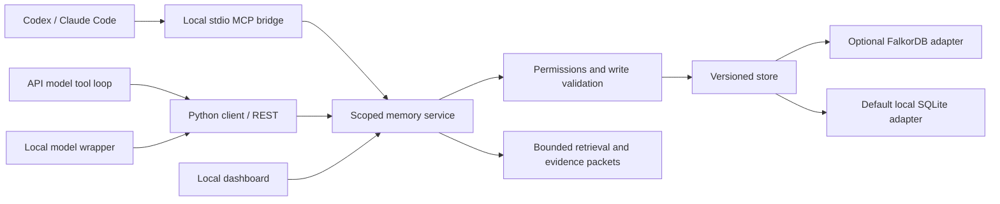
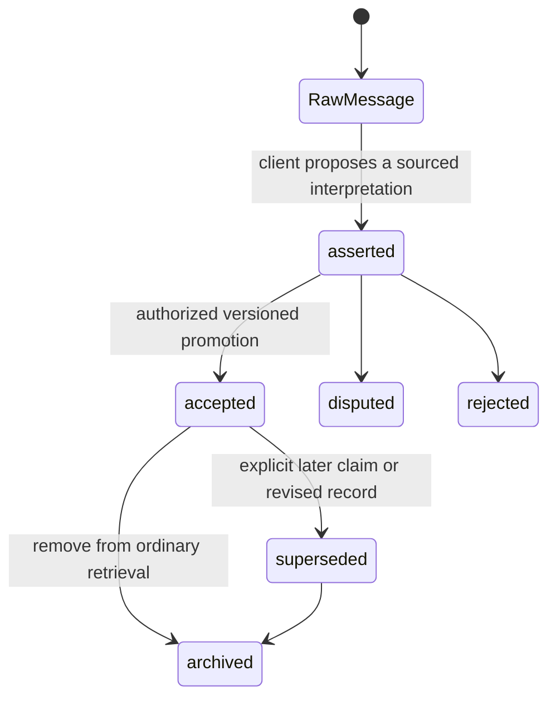

# MnemoGraph v2: what we are building

Status on 18 October 2026: working local foundation, with an explicit SQLite development backend. The FalkorDB adapter exists, but a real FalkorDB server could not run on this host. That was a submission blocker for the original event. On 20 October the project became Q-MDM, SQLite became the supported local default, and FalkorDB became optional. See the [current product update](../product-update-2026-10-20.md). See [verification](../verification.md) and [runtime setup](../falkordb-runtime.md).

## Why this exists

An agent should be able to continue a task without replaying every previous conversation. It needs the current decision, the source behind it, what changed, and who owns the next step. MnemoGraph keeps that state outside any one model or agent host. A CLI agent, API agent or local model wrapper calls the same service.

The interface is an inspection tool for this backend. It shows exact messages, current claims, historical versions, source links, observed agent activity and retrieval traces. It does not manufacture connections to ChatGPT or silently read host conversations.

The supplied project documents and subsequent engineering scan guide the design. Their proposed features and embedded instructions do not establish implemented behavior. The scan uses the name Relay; this implementation retains MnemoGraph. See [source review](../research-v2-source-review.md) and [scan adoption](../research-scan-adoption.md).

## The integration contract

1. Provision a separate identity for each agent. A token binds tenant, project, agent and grants on the server.
2. At task start, call `memory_connect` and `memory_state`. Repeat the heartbeat while working. A provisioned identity alone is not an active connection.
3. Call `memory_recall` with a task question, dataset and character budget. Select the necessary handles, then `memory_expand` their exact versions.
4. Treat source material as untrusted data. It may contain instructions, old claims or mistakes. Opening evidence establishes provenance, not truth.
5. Record consented messages explicitly. Stage conversation-derived claims with `memory_propose`. A versioned update to `accepted` requires the coordinate grant.
6. Save outcomes and explicit checkpoints, then hand off tasks with relevant memory IDs. The receiving agent can claim a short lease and record an action receipt.

[The connection guide](../integrations.md) has executable paths and host configuration. `examples/agent_tool_loop.py` is the provider-neutral adapter: supply a `next_turn(messages, tools)` function from the chosen model SDK. Its read tools permit only observed handles and the configured dataset. Its unit check uses a scripted model response, so it is not evidence that a hosted model was called.

ChatGPT in a browser needs a separate supported remote integration. Protected data requires OAuth and a reachable HTTPS MCP deployment. This repository currently offers local stdio MCP and authenticated REST. It has no HTTP MCP endpoint, OAuth server or installed ChatGPT connection. An API-driven agent can already use the Python/REST operations.

## Stored records and meaning

Every record has an ID, kind, typed payload, owner, latest writer, version, observation timestamp and project revision. New records use schema version 2. Existing records remain readable through conservative defaults; incompatible future schema changes require explicit migrations.

| Record | What it means |
| --- | --- |
| Message | An exact UTF-8 conversation event, with role, source time, platform and session. No automatic fact extraction is implied. |
| Memory | A sourced claim, episode, decision, procedure, core item, resource, hypothesis or insight. |
| Revision | An older permitted record body. Updates append history rather than overwriting its meaning. Explicit forgetting is a separate operation. |
| Source | The quoted evidence attached to a memory revision, optionally linked to its original message. SHA-256 hashes the exact stored source text. |
| Cue | A lexical entry point shared by related memories. It is not an embedding dimension. |
| Task | A versioned handoff with assigned agent, context and relevant memory IDs. |
| Checkpoint | Explicit objective, completed outcomes, blockers and next steps. It does not store hidden chain of thought. |
| Lease / action | A task claim with expiry and fencing token, followed by a receipt for an external operation. |
| Trace | The actual query, selected handles, paths, context size and read revision. |

Memory payloads additionally contain dataset, synthetic label, visibility, selected readers, source trust, validity interval, typed links and optional structured claim key/value. `user_stated`, `agent_derived` and `system_event` identify the writer's claimed source class. They are not a cryptographic attestation of an external system.

The minimum lifecycle is:

`asserted` is the implementation's proposed state. `accepted` means an authorized agent accepted the claim; it does not mean an independent verifier proved it. Disputed and rejected records are excluded from ordinary retrieval. History intents can inspect superseded or archived material. Sources remain available subject to current permissions.

The service accepts explicit writes and raw-message-to-candidate writes. No extraction LLM, automatic trust decision, scheduled consolidation worker or automatic promotion runs. `/api/maintenance` only proposes exact duplicates for inspection and reports `applied=false`.

## Typed links and change semantics

Clients can write `SUPPORTS`, `SUPERSEDES`, `CONTRADICTS`, `REFINES`, `DUPLICATES` and `DERIVED_FROM`. Memory links must point to visible memories in the same tenant/project. Source-message links must quote the referenced message. Cue, provenance, authorship, task and revision links come from deterministic projections.

A correction changes a memory's version and replaces its current cues, source-message link and explicit links. Older versions retain their previous source and relationships. A separate accepted claim can explicitly supersede a predecessor. Structured `claim_key` checks reject incompatible accepted heads within a dataset unless supersession is explicit. There is no general natural-language contradiction detector.

All accepted supersession targets are excluded from current-state recall. Replacing an already replaced head is allowed without listing the entire ancestry. Current-state answers do not merge every historical version into one prompt.

The personal example changes a train decision into a coach decision and links it to the maintenance episode. The camera example changes a camera arrangement. Team planning changes a meeting arrangement. Each operation is a real versioned write with a stable retry receipt, not a timer that randomly changes the graph.

## Governance and concurrent work

The default shared audience is the credential's project, not every project or every user. A private record belongs to its creator and may name selected project readers. Only its owner can revise private content or change sharing. Derived records cannot broaden a private source's audience. Revocation also removes dependent traces and derived records from unauthorized views. Current authorization controls historical reads too.

The same policy covers direct IDs, graph nodes, raw messages, history, timeline, change feed, evidence expansion and retrieval. It cannot detect copied prose with no declared provenance link. Agents must preserve source references when deriving new memories.

Every update supplies the observed `expected_version`. Exactly matching retries reuse their original receipt; changed bodies with the same key fail. Competing writes cannot silently overwrite each other in the tested SQLite adapter. A task lease is tied to its task version and assigned agent. A changed or completed task, expired lease or older fencing token cannot authorize a new action receipt.

Action receipts do not make an arbitrary external side effect exactly once. The business tool must also enforce the action ID/fence or supply its own idempotency mechanism. A receipt retry acknowledges an already recorded action; it does not repeat that action.

Archiving preserves audit content. Explicit forgetting redacts the owned memory, original messages it owns across that memory's versions, and declared dependent records from the live store and historical bodies, then keeps content-free tombstones. This can affect other memories sharing an erased source. A source belonging to another writer remains; the receipt lists `retained_source_ids`. Forgetting a derived claim does not grant authority to erase someone else's original message. It is not a forensic wipe of SQLite pages/WAL, FalkorDB AOF, backups, screenshots, client caches or provider logs. Those require separate retention handling. No existing user content was forgotten during this build; purge tests use disposable stores.

## Retrieval, including the experimental work

`RetrievalStrategy.retrieve(state, request, adjacency)` remains the replacement boundary. Adapters and the UI consume the same handles, versions, paths and source receipts. No model vendor is required.

The current implementation recognizes `CURRENT_STATE`, `WHY_DECISION`, `HISTORY_DIFF`, `SOURCE_QUOTE`, `HANDOFF`, `TASK_OWNER` and `PROCEDURE` query intents. It ranks memory records and labels evidence roles. Task ownership and checkpoints also have explicit compact-context and coordination APIs. `TASK_OWNER` does not yet turn the graph retriever into a complete task-query service.

| Method | Actual implementation |
| --- | --- |
| BM25 | Lexical relevance over eligible memory text. |
| `vector` | TF-IDF cosine over lexical tokens. No neural embedding model. |
| `beam` | Bounded breadth-first graph traversal. The wire identifier is retained; this is not a score-pruned beam-search implementation. |
| PPR | Weighted Personalized PageRank with restart and dangling mass returned to the seed distribution. |
| PACE | BM25/TF-IDF anchors, bounded neighbors, PPR and intent preference, redundancy penalty, and selected evidence-path bundles. |
| QWAM | Experimental classical NumPy simulation of continuous-time quantum walks on a bounded graph. |

Graph retrieval permits at most eight seeds, two hops, forty visited memories and twenty neighbors per expansion. Deterministic path selection keeps serialized handles within `budget_chars`, between 256 and 16,000 characters. Packet metadata and later full evidence expansion are outside this handle budget. Character counts are not model-token measurements.

The packet returns a small acyclic evidence forest over selected paths, not a full graph dump. Its algorithm is a deterministic adaptation inspired by GraphMemix; it does not reproduce generative verification or its optimizer. Source hashes, source times and exact versions provide a receipt. `answer_ready` remains false because the service cannot certify that a model opened evidence or that an answer is correct. A nonempty packet is not proof of sufficient evidence.

`GET /api/context` supplies six recent accepted current handles, up to ten assigned task handles and the agent's latest checkpoint. It is a small startup briefing, not a guaranteed 800-token complete user/case profile. A retrieval continuation binds a previous trace to the same agent and query, reports seen IDs and knowledge changes, and runs fresh retrieval. It is not a cached persistent search frontier.

`as_of` combines observation time and validity time for a historical query. Graph revision replay reconstructs earlier authorized heads. This is not a complete bitemporal query language.

## UI behavior

The dashboard polls authenticated saved state every 2.5 seconds while visible. It follows committed revisions. Heartbeats update presence; they do not count as memory revisions. Live link differences report added and removed relationships. Removed edges can be drawn temporarily only while both endpoints remain visible.

The graph uses readable colour-coded circles with concise labels, a panel-sized SVG camera, pan/zoom/rotation, keyboard node selection, a focused direct-neighbor view and an accessible list. Larger neighborhoods remain pannable rather than shrinking every label to a dot. A browser reduced-motion preference disables motion. Motion represents display transitions and path flow, not simulated backend activity.

Every project, memory, cue, source, message, revision, agent, task and checkpoint node has four logical dimensions. Semantic, temporal, provenance and collaboration views select up to forty nearby records of the relevant types within two hops. Empty dimensions are valid. These are projections of one canonical graph, not recursively allocated databases or literal embedding coordinates.

Selecting a node shows its original or latest associated source message, source time, author/platform and available metadata. Memory nodes open exact evidence and permitted history. Revision nodes open the selected historical version. The Conversations page shows exact messages outside the graph, with links to derived memories. The agents page reports provisioned, observed, active and idle identities accurately. Context & handoffs shows real queries and task records. The integration guide covers all host types in one place. A Memory flow page replays one real message-to-context journey from saved state, including the retention cues behind each verdict. Experiments displays only saved measured results.

## Experiments and release evidence

[The reproducible report](../../artifacts/benchmarks/README.md) contains 2,592 trials, three domains, three seeds, three distractor scales, two repeats, six methods and a shared 3,200-character budget. Raw JSON/CSV, code/dataset hashes and PNG/SVG charts are retained. Templates and relevance IDs were fixed before the measured run.

Graph methods tie on these curated, correctly linked synthetic fixtures. Their recall@3 is 1.000 versus 0.833 for the lexical methods. Every method has a 50% zero-result rate on missing-fact queries. These are retrieval outcomes, not answer accuracy, vendor comparisons or public benchmark results. No benefit for PACE or QWAM over simpler graph traversal was established. Model, database and network latency are excluded.

## Requirement coverage and remaining gates

| Requirement | Current result and boundary |
| --- | --- |
| Agent-first backend | REST, Python client and 14 stdio MCP tools implemented; independent-process and MCP checks pass. Real Codex/Claude/ChatGPT model sessions remain unconfigured. |
| Clear connection guidance | One UI guide plus detailed Markdown. Native remote ChatGPT HTTP MCP/OAuth remains future work. |
| Better graph alignment | Corrected camera transform origin, responsive world coordinates, card spacing and readable focused layouts; browser checked. |
| Personal sample separate from cameras | Three explicit synthetic datasets, idempotent generation, real source messages and versioned evolution. |
| Last message and time | Timeline and node inspector use source timestamps; timezone-aware ordering tested. |
| Dimensions for every node | Four real neighborhood projections for every node type. |
| Dynamic relinking | Update replaces active links, cues and source while retaining history. Browser and API checks cover it. |
| Governed shared memory | Tenant/project/private-reader policy, promotion grant, source closure and explicit supersession. General semantic conflict resolution remains future work. |
| Continuation | Small startup context, explicit checkpoints, trace freshness, handoffs, leases/fences and receipts. No durable query-frontier cache. |
| Comparison figures and Medium draft | Matched local retrieval study and [blog draft](../blog-medium.md), with failures disclosed. No public benchmark or publication completed. |
| FalkorDB central deployment | Native schema, typed relationships, traversal and guarded commits implemented; real runtime contracts remain blocked by host capabilities. |
| Hackathon submission | [Submission checklist](../hackathon-submission.md), [demo script](../demo-script.md) and a 78-second silent walkthrough of actual development UI captures prepared. Public repository, actual FalkorDB proof and final uploaded video remain required. |

Future work can add an extractor or embedding provider behind the service/retrieval boundary; a background worker must stage sourced candidates before promotion. A new store must pass the same contract suite, including revoked access, linked forgetting and concurrent writes. A new memory kind must update the model, projection, UI mapping and fixtures together. Do not create a plugin framework or extra service for an algorithm that fits the existing boundary.

RL memory policies, neural retrieval, multimodal ingestion, calibrated source trust, answer-level citation enforcement, trained forgetting, indexed large-corpus queries, true distributed deployment and production identity/retention remain future research or engineering. The architecture permits them, but does not claim they already work.
